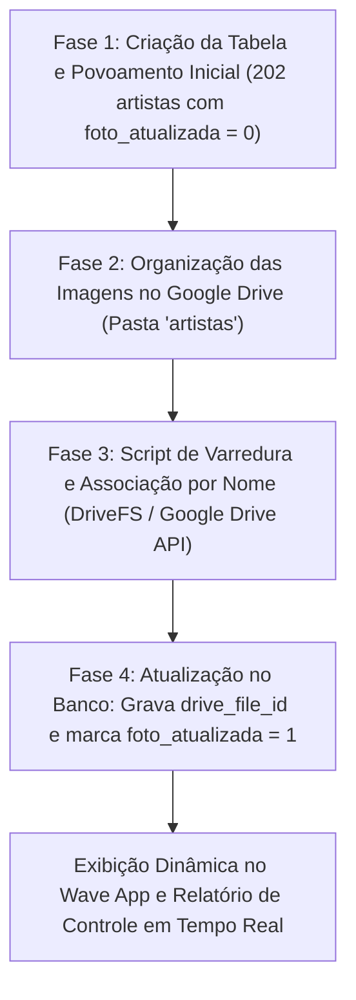

# 📸 Plano de Estruturação e Atualização de Fotos dos Artistas via Google Drive

Este documento detalha a arquitetura, campos de banco de dados, fluxo de sincronização e controle de status para associar fotos de perfil em alta resolução diretamente do **Google Drive** para todos os artistas cadastrados no ecossistema **Wave**.

---

## 1. Arquitetura da Tabela `artistas`

Criamos a tabela `artistas` com suporte nativo a arquivos de imagem armazenados no Google Drive e campo de controle para saber exatamente quais artistas já foram atualizados e quais continuam pendentes.

### Estrutura de Campos:
| Campo | Tipo | Descrição |
| :--- | :--- | :--- |
| `id` | BIGINT (PK) | Identificador único do artista |
| `nome` | VARCHAR(255) | Nome do artista (único) |
| `genero` | VARCHAR(100) | Gênero musical principal (Psytrance, Techno House, Hard Techno, etc.) |
| `drive_file_id` | VARCHAR(255) | **ID do arquivo de imagem no Google Drive** (ex: `1A2b3C...`) |
| `drive_url` | VARCHAR(500) | Link de visualização no Google Drive |
| `foto_perfil_url` | VARCHAR(500) | URL direta/thumbnail pública da imagem (`https://lh3.googleusercontent.com/d/{id}=s400`) |
| `foto_atualizada` | BOOLEAN | **Campo de Controle**: `true` (foto atualizada) / `false` (pendente) |
| `foto_atualizada_em` | TIMESTAMP | Data e hora em que a foto foi vinculada/atualizada |
| `bio` | TEXT | Biografia/descrição resumida do artista (opcional) |
| `timestamps` | TIMESTAMP | `created_at` e `updated_at` |

---

## 2. Fluxo de Trabalho e Sincronização em 4 Fases



---

## 3. Detalhamento das Fases

### Fase 1: Criação da Tabela & Povoamento Inicial
1. Executar a migration no Laravel ou o script SQL [`criar_tabela_artistas.sql`](file:///c:/FontesGit/wave/criar_tabela_artistas.sql) no MySQL da Hostinger.
2. O script executa um `INSERT IGNORE` trazendo automaticamente todos os **202 artistas** que já existem na tabela `musicas`.
3. Todos os artistas iniciam com:
   * `foto_atualizada = 0` (pendente)
   * `drive_file_id = NULL`

---

### Fase 2: Organização das Fotos no Google Drive
1. Criar uma pasta no Google Drive:
   * **Caminho Local:** `D:\Meu Drive\AplicativoGeral\artistas\`
2. Cada imagem deve ser salva com o nome exato do artista para correlação automática:
   * `Vegas.jpg` ou `Vegas.png`
   * `Astrix.jpg`
   * `Samuel Moriero.jpg`
   * `Mau P.jpg`
   * `Charlie Brown Jr.jpg`
3. O Google Drive sincroniza automaticamente os arquivos locais com a nuvem, gerando o `cloud_id` (`drive_file_id`) único para cada foto.

---

### Fase 3: Script de Sincronização Automática
O script em Python (ou comando no Laravel Artisan):
1. Conecta ao banco de metadados local do Google Drive (`mirror_metadata_sqlite.db`) ou via Google Drive API.
2. Lê todas as imagens dentro de `D:\Meu Drive\AplicativoGeral\artistas\`.
3. Para cada foto encontrada:
   * Extrai o nome do artista (removendo a extensão `.jpg`/`.png`).
   * Obtém o `cloud_id` do Google Drive.
   * Constrói a URL de exibição rápida: `https://lh3.googleusercontent.com/d/{cloud_id}=s400`.
   * Faz o update no banco de dados:
     ```sql
     UPDATE artistas 
     SET drive_file_id = :cloud_id,
         foto_perfil_url = :foto_url,
         foto_atualizada = 1,
         foto_atualizada_em = NOW()
     WHERE LOWER(TRIM(nome)) = LOWER(TRIM(:nome_artista));
     ```

---

### Fase 4: Painel de Controle e Monitoramento

Para acompanhar o progresso de quais artistas já tiveram suas fotos atualizadas:

```sql
SELECT 
    COUNT(*) AS total_artistas,
    SUM(CASE WHEN foto_atualizada = 1 THEN 1 ELSE 0 END) AS fotos_concluidas,
    SUM(CASE WHEN foto_atualizada = 0 THEN 1 ELSE 0 END) AS fotos_pendentes,
    CONCAT(ROUND((SUM(CASE WHEN foto_atualizada = 1 THEN 1 ELSE 0 END) / COUNT(*)) * 100, 1), '%') AS percentual_concluido
FROM artistas;
```

Para listar os artistas que **ainda faltam atualizar**:
```sql
SELECT id, nome, genero FROM artistas WHERE foto_atualizada = 0 ORDER BY genero, nome;
```

---

## 5. Integração com a API do Wave

No backend (`MusicaController@artistas` e `MusicaController@home`):
* A consulta passa a fazer `LEFT JOIN` com a tabela `artistas` onde `artistas.nome = musicas.artista`.
* Se `foto_atualizada = 1` e `foto_perfil_url` existir, envia a foto oficial do Google Drive.
* Se `foto_atualizada = 0`, mantém o fallback elegante atual.
* Dessa forma, à medida que você for adicionando fotos no Google Drive, os carrosséis do Wave atualizarão as fotos dos artistas sem quebrar nenhum layout!
